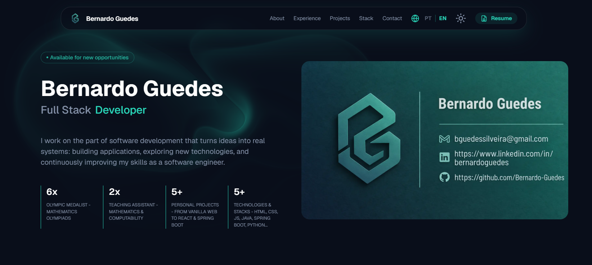
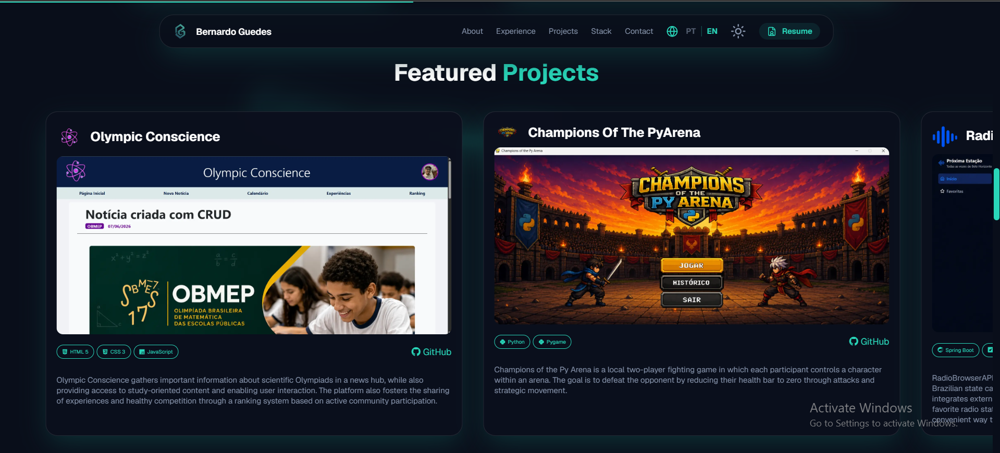
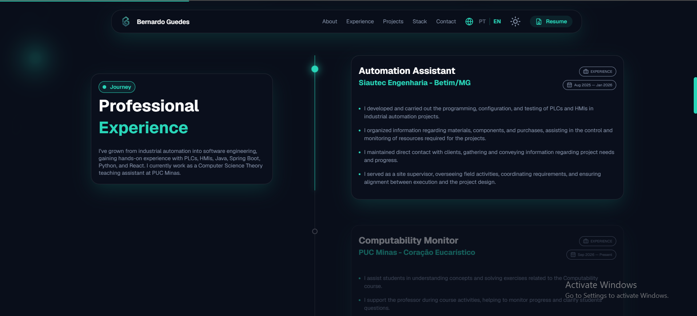
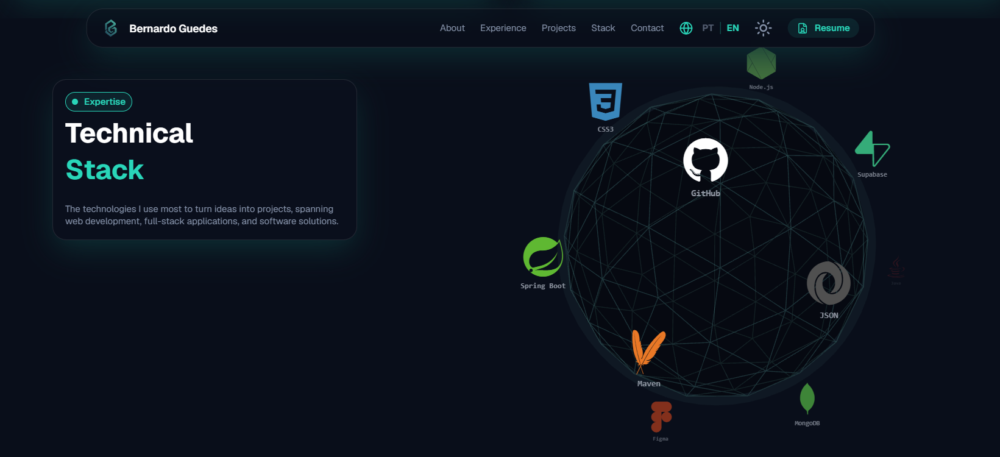
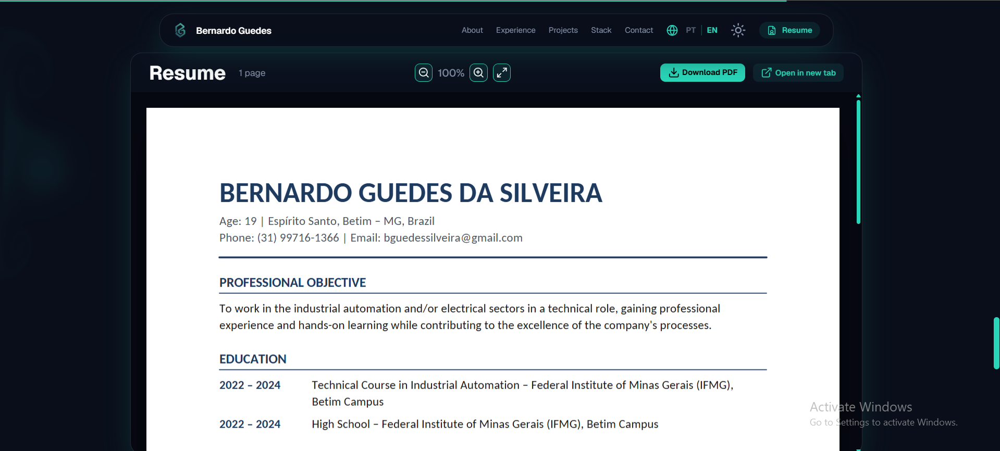
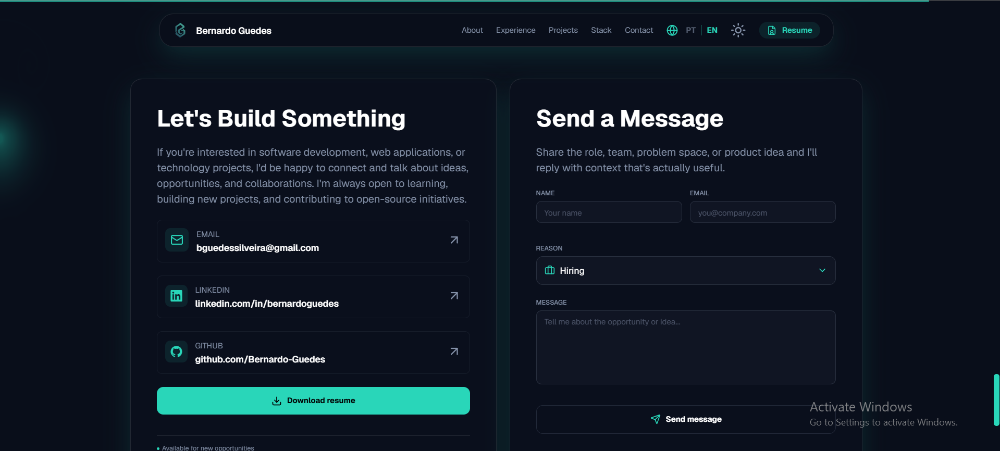

# 💻 Bernardo Guedes | Portfólio Profissional

<table>
  <tr>
    <td width="800">
      <div align="justify">
        Portfólio pessoal desenvolvido com React, TypeScript e Vite para apresentar minha trajetória, meus projetos e minhas habilidades técnicas como estudante de Engenharia de Software e desenvolvedor Full Stack em formação. A aplicação é bilíngue (PT/EN), tem tema claro e escuro, interface animada e responsiva, globo 3D interativo com as tecnologias que utilizo, visualizador de currículo em PDF e formulário de contato com envio direto para o meu e-mail. Além de ser minha vitrine profissional, o projeto também é um laboratório para aplicar boas práticas de front-end e engenharia de software.
      </div>
    </td>
    <td width="150" align="center">
      <div>
        
      </div>
    </td>
  </tr>
</table>

[](https://github.com/Bernardo-Guedes/portfolio/releases)         

---

## 📚 Índice
- [Links Úteis](#-links-úteis)
- [Sobre o Projeto](#-sobre-o-projeto)
- [Funcionalidades Principais](#-funcionalidades-principais)
- [Tecnologias Utilizadas](#-tecnologias-utilizadas)
- [Arquitetura](#-arquitetura)
- [Instalação e Execução](#-instalação-e-execução)
  - [Pré-requisitos](#pré-requisitos)
  - [Variáveis de Ambiente](#-variáveis-de-ambiente)
  - [Como Executar](#-como-executar)
  - [Scripts Disponíveis](#-scripts-disponíveis)
- [Deploy](#-deploy)
- [Personalização](#-personalização)
- [Estrutura de Pastas](#-estrutura-de-pastas)
- [Protótipos](#-protótipos)
- [Documentações utilizadas](#-documentações-utilizadas)
- [Autor](#-autor)
- [Agradecimentos e Créditos](#-agradecimentos-e-créditos)
- [Licença](#-licença)

---

## 🔗 Links Úteis
* 🌐 **Aplicação Web:** [Acesse o portfólio](https://bernardo-guedes-portfolio.vercel.app)
  > **Descrição:** Versão em produção do portfólio, hospedada na Vercel.
* 🎨 **Protótipo Interativo:** [Acesse o protótipo no Figma](https://www.figma.com/proto/CX8ojhktk4RutVjwMLo7To/Prot%C3%B3tipo-Portf%C3%B3lio?node-id=1-2&p=f&t=LAfmYCIotEAkYZTd-0&scaling=min-zoom&content-scaling=fixed&page-id=0%3A1&starting-point-node-id=1%3A2&show-proto-sidebar=1)
  > **Descrição:** Protótipo navegável criado antes do desenvolvimento.
* 📦 **Repositório:** [Bernardo-Guedes/portfolio](https://github.com/Bernardo-Guedes/portfolio)
  > **Descrição:** Código-fonte do projeto no GitHub.
---

## 📝 Sobre o Projeto

Este portfólio nasceu da necessidade de reunir em um só lugar a minha trajetória como estudante de Engenharia de Software: projetos, experiências, habilidades técnicas e formas de contato. Em vez de depender apenas de um currículo em PDF ou de perfis espalhados em diferentes plataformas, a ideia é oferecer uma apresentação profissional, organizada e fácil de navegar para recrutadores, professores e outros desenvolvedores.

O projeto foi desenvolvido no contexto acadêmico da **PUC Minas**, mas com foco em uso real: ele serve como minha vitrine profissional e pode ser compartilhado em processos seletivos, candidaturas a estágio e networking. Quem visita encontra rapidamente quem sou, o que já construí (com links para os repositórios no GitHub) e como falar comigo, em português ou inglês.

Também é um projeto de aprendizado: ele me permite aprofundar conhecimentos em React, TypeScript, Tailwind CSS, internacionalização, animações, WebGL/3D e boas práticas como documentação, versionamento, prototipação no Figma e organização de código.

---

## ✨ Funcionalidades Principais

- 🏠 **Home:** apresentação com destaques numéricos (medalhas, monitorias, projetos e tecnologias) e cartão de perfil com efeito *tilt* 3D (visível em telas grandes).
- 🙋 **Sobre mim:** perfil, cargo atual, localização, formação acadêmica e cartões de estatísticas.
- 🧭 **Experiência:** linha do tempo com barra de progresso animada conforme o scroll.
- 🗂️ **Projetos em destaque:** seção com rolagem horizontal guiada pelo scroll (em telas `xl`), com imagem, tecnologias e link do GitHub de cada projeto.
- 🌐 **Stack tecnológica:** globo 3D interativo (Three.js + React Three Fiber) com os ícones das tecnologias, que pausa a renderização quando sai da tela.
- 📄 **Currículo integrado:** visualizador de PDF com zoom, download e abertura em nova aba, com arquivo diferente por idioma.
- ✉️ **Formulário de contato:** validação de campos, seleção de motivo, proteção *honeypot* contra bots e envio por e-mail via EmailJS.
- 🔗 **Links de contato:** e-mail, LinkedIn e GitHub.
- 🌎 **Bilíngue (PT/EN):** alternância no cabeçalho; o idioma inicial considera o parâmetro `?lang=`, a escolha salva e o idioma do navegador.
- 🌗 **Tema claro e escuro:** alternância no cabeçalho, com preferência salva e fallback para o tema do sistema.
- 📱 **Responsivo:** menu mobile, layouts adaptados e efeitos desativados onde não fazem sentido.
- 🖱️ **Interface animada:** cursor com efeito de fluido (apenas em dispositivos com mouse), barra de progresso de leitura e transições suaves.
- 🛡️ **Resiliência:** componentes pesados (globo 3D e currículo) são carregados sob demanda e protegidos por *Error Boundary*, para que uma falha não derrube a página inteira.
---

## 🛠 Tecnologias Utilizadas

### 💻 Front-end

* **Biblioteca:** [React 19](https://react.dev/)
* **Linguagem:** [TypeScript](https://www.typescriptlang.org/)
* **Build Tool:** [Vite](https://vite.dev/)
* **Estilização:** [Tailwind CSS 4](https://tailwindcss.com/), [tw-animate-css](https://github.com/Wombosvideo/tw-animate-css) e variáveis CSS para os temas
* **Componentes de UI:** [Base UI](https://base-ui.com/) (Select) com convenções do [shadcn/ui](https://ui.shadcn.com/)
* **Animações:** [Motion](https://motion.dev/)
* **3D:** [Three.js](https://threejs.org/), [React Three Fiber](https://r3f.docs.pmnd.rs/) e [Drei](https://drei.docs.pmnd.rs/)
* **Visualização de PDF:** [react-pdf](https://github.com/wojtekmaj/react-pdf) (PDF.js)
* **Internacionalização (PT/EN):** [i18next](https://www.i18next.com/) e [react-i18next](https://react.i18next.com/)
* **Ícones:** [Lucide](https://lucide.dev/) e [Devicon](https://devicon.dev/)
* **Fonte:** [Geist Variable](https://fontsource.org/fonts/geist)

### 🖥️ Serviços Externos
 
O projeto **não possui back-end próprio**. O único serviço externo é:
 
* **Envio de e-mail (formulário de contato):** [EmailJS](https://www.emailjs.com/)


### ⚙️ Infraestrutura e Ferramentas
 
* **Hospedagem:** [Vercel](https://vercel.com/)
* **Análise estática:** [ESLint](https://eslint.org/) com `typescript-eslint` e `eslint-plugin-react-hooks`
* **Protótipos:** [Figma](https://www.figma.com/)
* **Versionamento:** [Git](https://git-scm.com/) e [GitHub](https://github.com/)

---

## 🏗 Arquitetura
 
O portfólio é uma **Single Page Application** sem roteador: cada seção é uma "página" (`src/pages`) renderizada em sequência no `App.tsx` e acessada por âncoras (`#home`, `#about`, `#experience`, `#projects`, `#skills`, `#resume`, `#contact`).
 
```text
App.tsx
├── SplashCursor      (somente em dispositivos com mouse)
├── ScrollProgress + Header
├── Home → About → Experience → Projects (scroll horizontal)
├── Skills            (SkillsGlobe carregado com lazy + Suspense)
├── Resume            (react-pdf carregado com lazy + Suspense)
├── Contact           (formulário → emailService → EmailJS)
└── Footer
```

**Decisões importantes**
 
- **Internacionalização centralizada:** todos os textos ficam em `src/i18n.ts` (chaves `pt` e `en`). O `<html lang>` é atualizado automaticamente quando o idioma muda.
- **Temas por variáveis CSS:** o tema escuro é ativado pela classe `.dark` no `<html>`; cores como `--text`, `--title`, `--bg` e `--card-bg` são definidas em `src/index.css`, e a cor de destaque (`turquesa`, `#29d6b9`) é um token do Tailwind.
- **Carregamento sob demanda:** Three.js e PDF.js são pesados, então `SkillsGlobe` e `Resume` usam `React.lazy`, e o globo só renderiza enquanto está visível (`IntersectionObserver`).
- **Tolerância a falhas:** `SafeBoundary` captura erros de execução dos módulos opcionais (cursor, globo e currículo), exibindo um fallback.
- **Polyfills:** `src/polyfills.ts` adiciona `Map.prototype.getOrInsertComputed` e o iterador assíncrono de `ReadableStream`, necessários para o PDF.js em alguns navegadores.
---

## 🔧 Instalação e Execução
 
### Pré-requisitos
 
* **Node.js:** versão **22.13** ou superior (o Vite 8 exige 20.19+/22.12+, e o `pdfjs-dist` pede 22.13+)
* **Gerenciador de pacotes:** npm (já incluso no Node.js)
* **Conta no [EmailJS](https://www.emailjs.com/)** (opcional, apenas para testar o envio do formulário de contato)
---

### 🔑 Variáveis de Ambiente
 
Crie um arquivo **`.env.local`** na raiz do projeto (ele não é versionado). O prefixo `VITE_` é obrigatório para que o Vite exponha as variáveis ao código do navegador.
 
| Variável | Descrição |
| :--- | :--- |
| `VITE_EMAILJS_SERVICE_ID` | ID do serviço de e-mail configurado no EmailJS. |
| `VITE_EMAILJS_TEMPLATE_ID` | ID do template de e-mail do EmailJS. |
| `VITE_EMAILJS_PUBLIC_KEY` | Chave pública (*Public Key*) da sua conta EmailJS. |
 
```env
VITE_EMAILJS_SERVICE_ID=seu_service_id_aqui
VITE_EMAILJS_TEMPLATE_ID=seu_template_id_aqui
VITE_EMAILJS_PUBLIC_KEY=sua_public_key_aqui
```
 
> 💡 O template do EmailJS deve usar as variáveis `{{name}}`, `{{email}}`, `{{reason}}` e `{{message}}`, que são as enviadas pelo formulário.
 
> ⚠️ Sem essas variáveis o site funciona normalmente, mas o envio do formulário de contato retornará erro.
 
---

### ⚡ Como Executar
 
1. **Clone o repositório:**
```bash
git clone https://github.com/Bernardo-Guedes/portfolio.git
cd portfolio
```
 
2. **Instale as dependências:**
```bash
npm install
```
 
3. **Configure as variáveis de ambiente** (veja a seção anterior).
4. **Inicie o servidor de desenvolvimento:**
```bash
npm run dev
```
 
🎨 *A aplicação estará disponível em **http://localhost:5173**.*
 
> 💡 Para abrir direto em um idioma, use `http://localhost:5173/?lang=en` ou `?lang=pt`.
 
---

### 📜 Scripts Disponíveis
 
| Script | Descrição |
| :--- | :--- |
| `npm run dev` | Inicia o servidor de desenvolvimento com *hot reload*. |
| `npm run build` | Verifica os tipos (`tsc -b`) e gera a versão de produção em `/dist`. |
| `npm run preview` | Serve localmente a build de produção para conferência. |
| `npm run lint` | Executa o ESLint em todo o projeto. |
 
---
 
## 🚀 Deploy
 
O projeto é hospedado na **Vercel**, com deploy automático a cada *push* na branch `main`.
 
1. **Gere a build de produção** (opcional, para conferir localmente):
```bash
npm run build
npm run preview
```
 
2. **Importe o repositório** na [Vercel](https://vercel.com/new). O Vite é detectado automaticamente (comando de build `npm run build`, pasta de saída `dist`).
3. **Configure as variáveis de ambiente** em *Project Settings > Environment Variables*:
```text
VITE_EMAILJS_SERVICE_ID
VITE_EMAILJS_TEMPLATE_ID
VITE_EMAILJS_PUBLIC_KEY
```
 
> 🔑 Como o EmailJS roda no navegador, a chave pública fica visível no *bundle*. Isso é esperado, mas vale restringir os domínios permitidos nas configurações da sua conta EmailJS.
 
---
 
## 🎛️ Personalização
 
Quer usar este projeto como base para o seu próprio portfólio? Os pontos principais são:
 
| O que alterar | Onde |
| :--- | :--- |
| Textos, experiências, formação e projetos (PT/EN) | `src/i18n.ts` |
| Lista de projetos (imagens, tecnologias e links do GitHub) | `src/components/MotiomScrollHorizontal.tsx` |
| Tecnologias exibidas no globo 3D | `DEFAULT_SKILLS` em `src/components/SkillsGlobe.tsx` |
| Cores e temas | `src/index.css` |
| Currículos em PDF | `public/cv-pt.pdf` e `public/cv-en.pdf` |
| Links de contato | `Contact.tsx` e `Footer.tsx` |
| Cursor personalizado | `public/cursor.svg` e `public/cursor-pointer.svg` |
 
---
 
## 📂 Estrutura de Pastas
 
```text
.
├── docs/                         # 📚 Documentação do projeto.
│   ├── prototype/                # 🎨 Telas do protótipo do Figma.
│   └── images/                   # 🖼️ Imagens usadas neste README.
│
├── public/                       # 🌐 Arquivos públicos servidos diretamente.
│   ├── cv-pt.pdf                 # 📄 Currículo em português.
│   ├── cv-en.pdf                 # 📄 Currículo em inglês.
│   ├── cursor.svg                # 🖱️ Cursor padrão personalizado.
│   └── cursor-pointer.svg        # 👆 Cursor de elementos clicáveis.
│
├── src/                          # 💻 Código-fonte da aplicação React.
│   ├── assets/images/            # 🖼️ Logos, prints dos projetos e cartão de perfil.
│   ├── components/               # 🧱 Componentes reutilizáveis (Header, Footer, Cards, SkillsGlobe, SplashCursor...).
│   ├── lib/utils.ts              # 🛠️ Utilitários (função `cn` para classes).
│   ├── pages/                    # 📄 Seções da página (Home, About, Experience, Skills, Resume, Contact).
│   ├── services/emailService.ts  # 🔌 Integração com o EmailJS.
│   ├── App.tsx                   # ⚛️ Composição das seções da aplicação.
│   ├── i18n.ts                   # 🌎 Configuração e textos PT/EN.
│   ├── index.css                 # 🎨 Estilos globais, temas e tokens do Tailwind.
│   ├── polyfills.ts              # 🩹 Polyfills para compatibilidade com o PDF.js.
│   └── main.tsx                  # 🚀 Ponto de entrada da aplicação.
│
├── .gitignore                    # 🚫 Arquivos e pastas ignorados pelo Git.
├── components.json               # ⚙️ Configuração do shadcn/ui.
├── eslint.config.js              # ✨ Regras do ESLint.
├── index.html                    # 🌐 Documento HTML principal.
├── LICENSE                       # ⚖️ Licença do projeto.
├── package.json                  # 📦 Dependências, scripts e metadados.
├── package-lock.json             # 🔒 Versões exatas das dependências.
├── README.md                     # 📘 Documentação principal.
├── tsconfig.json                 # ⚙️ Configuração geral do TypeScript.
├── tsconfig.app.json             # ⚙️ TypeScript da aplicação.
├── tsconfig.node.json            # ⚙️ TypeScript das ferramentas Node.js.
└── vite.config.ts                # ⚡ Configuração do Vite.
```
---

## 🎨 Protótipos

| Página Inicial | Página Sobre |
|----------------|----------------|
|  |  |

| Página Experiências | Página Projetos |
|----------------|----------------|
|  |  |

| Página Stack e Ferramentas | Página Contatos |
|----------------|----------------|
|  |  |

| Página Inicial - Tema Claro | Página Sobre - Tema Claro |
|----------------|----------------|
|  |  |

| Página Inicial | Página Sobre | Página Experiências| Página Projetos |
|----------------|----------------|----------------|----------------|
|  |  |  |  |

---

## 🎥 Demonstração

| Página Inicial |
|----------------|
|  |

| Página Projetos em Destaque |
|-----------------------------|
|  |

| Página Experiências |
|----------------|
|  |

| Página Skills |
|----------------|
|  |

| Página Currículo |
|-----------------------------|
|  |


| Página Contatos |
|-----------------------------|
|  |


---

## 🔗 Documentações utilizadas
 
- 📖 **Biblioteca (Front-end):** [Documentação Oficial do React](https://react.dev/)
- 📖 **Build Tool:** [Guia de Configuração do Vite](https://vite.dev/guide/)
- 📖 **Linguagem:** [Documentação Oficial do TypeScript](https://www.typescriptlang.org/docs/)
- 📖 **Estilização:** [Documentação Oficial do Tailwind CSS](https://tailwindcss.com/docs)
- 📖 **Componentes de UI:** [Base UI](https://base-ui.com/react/overview/quick-start) e [shadcn/ui](https://ui.shadcn.com/docs)
- 📖 **Animações:** [Documentação do Motion](https://motion.dev/docs/react)
- 📖 **3D:** [React Three Fiber](https://r3f.docs.pmnd.rs/getting-started/introduction) e [Three.js](https://threejs.org/docs/)
- 📖 **PDF:** [Documentação do react-pdf](https://github.com/wojtekmaj/react-pdf#readme)
- 📖 **Internacionalização (i18n):** [Documentação do react-i18next](https://react.i18next.com/)
- 📖 **Ícones:** [Lucide React](https://lucide.dev/guide/packages/lucide-react) e [Devicon](https://devicon.dev/)
- 📖 **Envio de E-mails:** [Documentação Oficial do EmailJS](https://www.emailjs.com/docs/)
- 📖 **Hospedagem e Deploy:** [Documentação Oficial da Vercel](https://vercel.com/docs)


---

## 👥 Autor

| Nome | Foto | GitHub | LinkedIn | Gmail |
|---------|----------|-----------------|-------------|-----------|
| Bernardo Guedes  | <div align="center"></div> | <div align="center"><a href="https://github.com/Bernardo-Guedes"></a></div> | <div align="center"><a href="https://www.linkedin.com/in/bernardoguedes"></a></div> | <div align="center"><a href="mailto:bguedessilveira@gmail.com"></a></div> |

---

## 🙏 Agradecimentos

Gostaria de agradecer aos seguintes canais e pessoas que foram fundamentais para o desenvolvimento deste projeto:

* [**Engenharia de Software PUC Minas**](https://www.instagram.com/engsoftwarepucminas/) - Pelo apoio institucional, estrutura acadêmica e fomento à inovação e boas práticas de engenharia.
* [**Prof. Dr. João Paulo Aramuni**](https://github.com/joaopauloaramuni) - Pelos valiosos ensinamentos sobre **Arquitetura de Software** e **Padrões de Projeto**.

---

## 📄 Licença

Este projeto é distribuído sob a **[Licença MIT](https://github.com/Bernardo-Guedes/portfolio/blob/main/LICENSE)**.

---